# Touch OS

A **GNOME 50** desktop made to be touched. Everything you tap is thumb-sized, surfaces are soft and large instead of
outlined, and the screen's edges are the interface: pull up from the bottom for Home, pull down from the top for the
menus, slide along the bottom to flip between apps. It was built for a convertible laptop (a Lenovo IdeaPad Flex 5)
used with fingers, and it still works with a keyboard and a mouse.

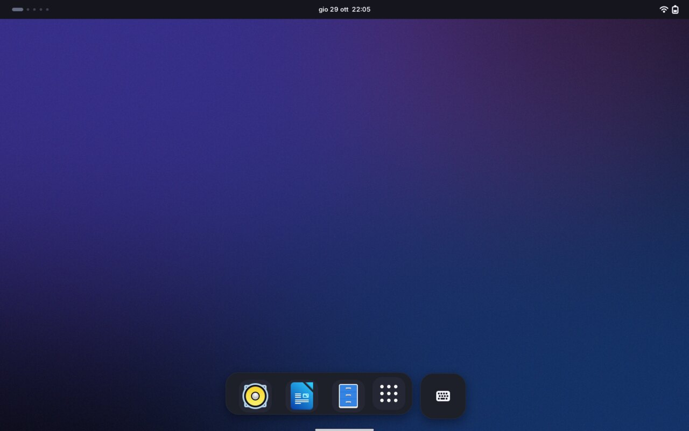

| Shelf over an app | Flipping apps | Home |
|---|---|---|
| 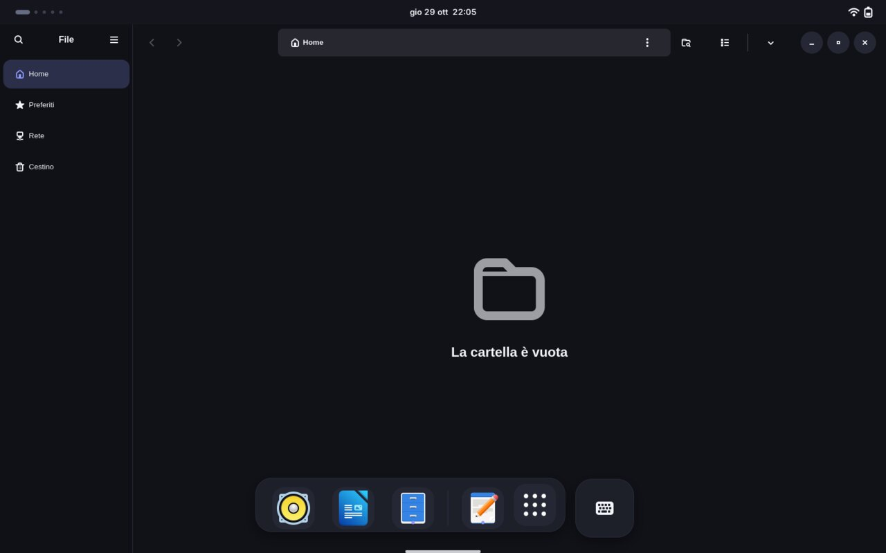 | 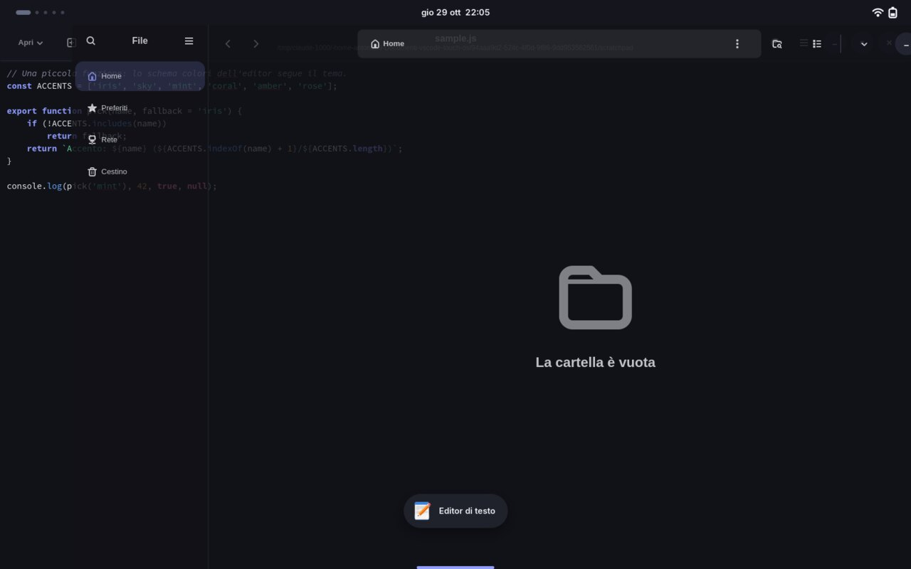 | 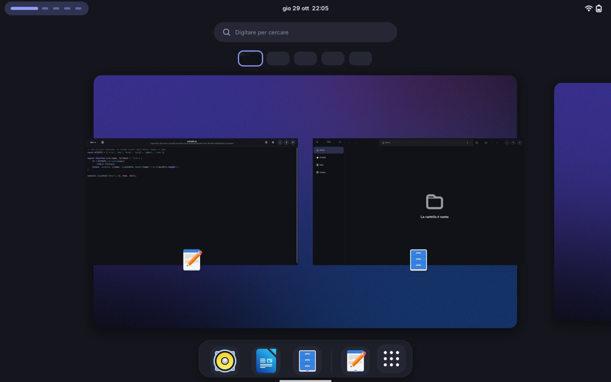 |

> The images are real screenshots of a GNOME Shell 50 with Touch OS installed, taken in the headless test bench
> (`tools/shell-test/`) with a virtual touchscreen: the fingers you see acting are real touch events. Light mode is below.

> **Language:** the installer messages and the settings panel are in Italian only for now (the documentation is in
> English), like the sibling projects Glassy and Outkast OS.

## The idea in four lines

- **Thumb-sized.** Buttons are 48px tall, list rows 64px, header bars 56px, switches about 70×38, sliders have 28px knobs,
  the window buttons are 40px circles. Nothing you aim at with a finger is smaller than 44px. The *Target size* setting
  scales all of it (80–140%).
- **Soft, not outlined.** Surfaces are fills that get lighter as they rise (`view < window < card < dialog < raised`),
  with big concentric corners (20px windows, 14px controls) and a soft shadow only on what floats: menus, dialogs, the
  dock, the keyboard. No 1px borders: those are for people with a pointer.
- **The edges are the interface.** A finger that starts at the bottom edge goes Home; one that starts at the top edge opens
  a menu. A thin *pill* at the bottom centre says where, but you don't have to aim at it.
- **GNOME underneath.** Home is GNOME's own overview, the Shelf is GNOME's own Dash, the keyboard is GNOME's own on-screen
  keyboard. Touch OS restyles them and wires gestures to them instead of reimplementing them, so they keep behaving
  like GNOME (drag to reorder, long-press for the app menu, the same inertia and thresholds).

## Installation

```bash
./install.sh
```

It does everything on its own: it shows what it is going to do, asks for confirmation, saves your original settings,
and installs

- the **Touch** theme for GTK4/libadwaita, GTK3 and GNOME Shell (dark and light, following the system scheme: the Shell has
  a light and a dark stylesheet in GNOME 50 and so does Touch OS);
- the **Tela** icons in the variant that matches the accent (by Vinceliuice, GPL-3.0): if a `Tela-<variant>/` folder sits
  next to `install.sh` it uses that, otherwise it downloads a pinned release from GitHub and verifies its SHA-256;
- the Touch wallpapers (dark and light);
- the **Touch Shell** extension (written for this project, in `extension/`): gestures, pill, Shelf, tablet mode;
- a color scheme for **GtkSourceView** (Text Editor, Builder…) and a palette for **Ptyxis**; ready-made files for alacritty,
  kitty, foot and ghostty;
- desktop settings: hot corner off (a finger grazing the corner must not open anything), system text at 1.1×, clock with
  weekday and date, window buttons on the right, edge tiling on;
- a **Touch OS Settings** entry in the app menu.

No extension is downloaded from extensions.gnome.org: the extension loads the Shell stylesheet itself.

Then **log out and back in**: GNOME Shell cannot be restarted in place on Wayland, so the gestures and the Shelf only
start at the next login.

> **Apps that are already open keep their old style.** GNOME apps read the theme when they start, and Nautilus stays in
> memory even with all windows closed: until you restart it (`nautilus -q`, or log out and in) it keeps the previous
> style. The installer offers to close it for you.

Requirements: GNOME Shell 50 (the extension declares compatibility with 50 only; the theme needs GNOME 47+ for the CSS
variables), `gjs`, `curl` or `wget`, `tar`, `xz`, `sha256sum` and `glib-compile-schemas`. The installer tells you what is
missing.

### Options

```
./install.sh --accent coral         iris (default) sky mint coral amber rose: the signal color
./install.sh --light                light scheme (default: dark)
./install.sh --text-scale 1.25      system text size, 0.9–1.5 (default 1.1; 1.0 leaves it as it is)
./install.sh --no-extension         theme and icons only: no gestures, Shelf or tablet mode
./install.sh --no-extras            no editor/terminal schemes
./install.sh --no-icons  --no-wallpaper  --no-flatpak
./install.sh --restart-apps         close Nautilus without asking
./install.sh --dry-run              show what it would do, change nothing
./install.sh -y                     no confirmation prompt
```

You can re-run it whenever you like (to update, to change the accent): it duplicates nothing and keeps the original
backup. A color, scheme or text size you chose in the settings panel is not overwritten unless you pass the option again.

### Heads-up: the layout changes

The Shelf and the gestures take over the bottom and top edges, so the installer **disables** (without removing) extensions
that do similar things or fight over the same space: Dash to Panel, Dash to Dock, ArcMenu, Start Menu, Ubuntu Dock,
Dash2Dock, Magic Lamp, Compiz windows effect, Burn My Windows, Blur my Shell, and the sibling desktops **Outkast OS** and
**Glassy**. It lists them before proceeding. With `--no-extension` it touches nothing of the sort.

**Touch OS, Outkast OS and Glassy are three complete desktops: use one at a time.** If one of the others is installed,
`./install.sh` says so and turns its extension off, but for a clean switch run that one's `./uninstall.sh` first (they all
manage `~/.config/gtk-*/gtk.css`).

## Using it with your fingers

| You do | You get |
|---|---|
| Pull **up** from the bottom edge | **Home**: GNOME's overview, following your finger (your windows). Pull up again, inside Home, for all apps |
| Slide **right** along the bottom edge | the previous app. The current one follows your finger and fades, a chip says where you are going |
| Slide **left** along the bottom edge | the app you used least recently (so right-right toggles between two apps) |
| Tap the **pill** | the **Shelf** (dock); tap it again to close it |
| Pull **down** from the top edge, right half | quick settings (network, sound, brightness, battery, power) |
| Pull **down** from the top edge, left half | notifications and calendar |
| **Long-press** a window in Home | its title and a 44px close button (GNOME's own gesture) |
| **Long-press** an icon in the Shelf | the app's menu (GNOME's own) |
| Three fingers, up or left/right | GNOME's own: overview, workspaces |

| Quick settings | Notifications and calendar | On-screen keyboard |
|---|---|---|
| 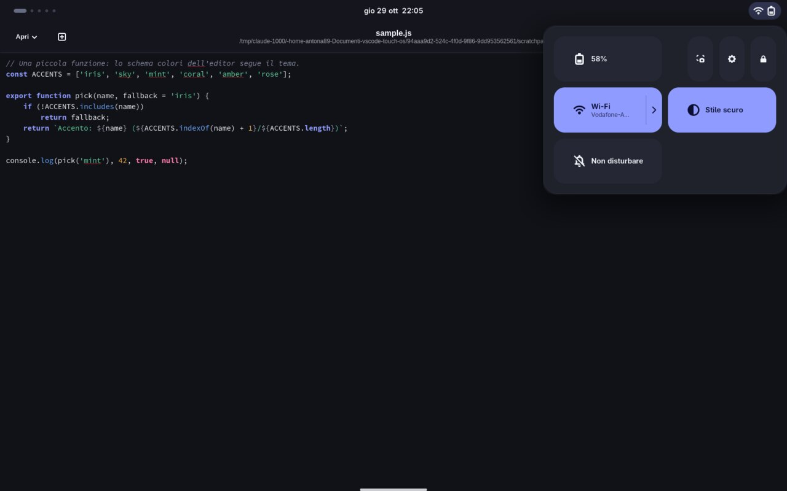 | 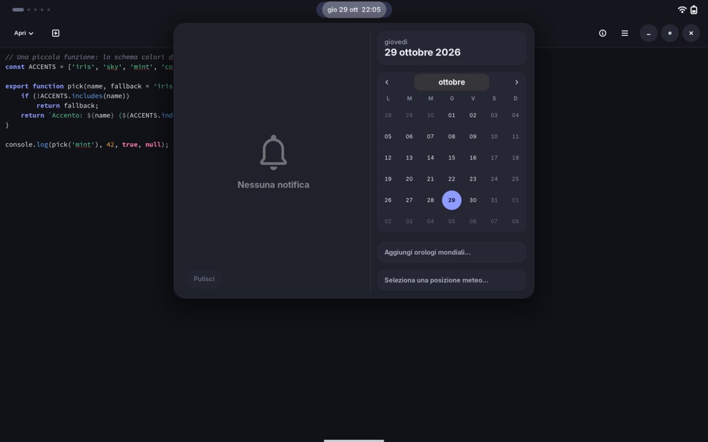 | 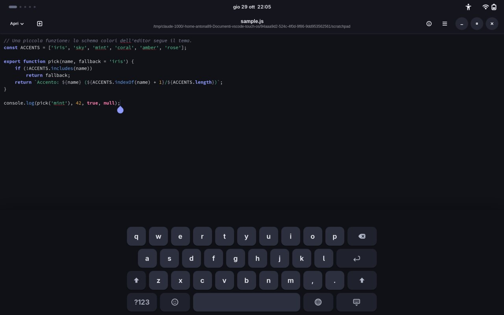 |

The touch zone is 28px high along the whole bottom edge (and 22px along the top): you don't have to hit the pill. A tap that
starts there and doesn't move reaches the app below as usual. Gestures only answer **fingers on a touchscreen**: the
pointer and the touchpad keep GNOME's own behaviour.

### The Shelf

A floating dock with your favorite apps and the running ones, a grid button for all apps and, on its own island, a
**keyboard** button for apps that don't ask for the on-screen keyboard by themselves. It rises with a soft slide and
fade, and closes when you tap outside it, when an app starts or comes to the front, when Home opens or after a few
seconds without touching it. **On an empty desktop it stays open**: it is the home screen until there is a window.

It is GNOME's real Dash, so drag to reorder and the long-press menu work as in the overview.

### Tablet mode

New windows open **maximized**: on a touch screen a half-size window is mostly a harder target and an edge to resize with a
finger. Dialogs, child windows and windows that cannot be maximized are left alone. Put two apps side by side by dragging a
window to the edge (GNOME's own tiling, styled to match).

### The top bar

It has the same color as an app's header bar, so at the top of a maximized app the two read as one surface. With the top-edge
gesture on, **touching the bar no longer starts dragging the maximized window** (GNOME's default, which would tear the
window away from you while you are trying to open quick settings); with the mouse nothing changes.

### On-screen keyboard

The keyboard is GNOME's, with big rounded keys and a pressed state that lights up in the accent color. It appears by itself
when you tap a text field. GNOME also uses the bottom edge to pull the keyboard up; here that edge is Home's, so the
keyboard has its button in the Shelf instead.

### Light mode

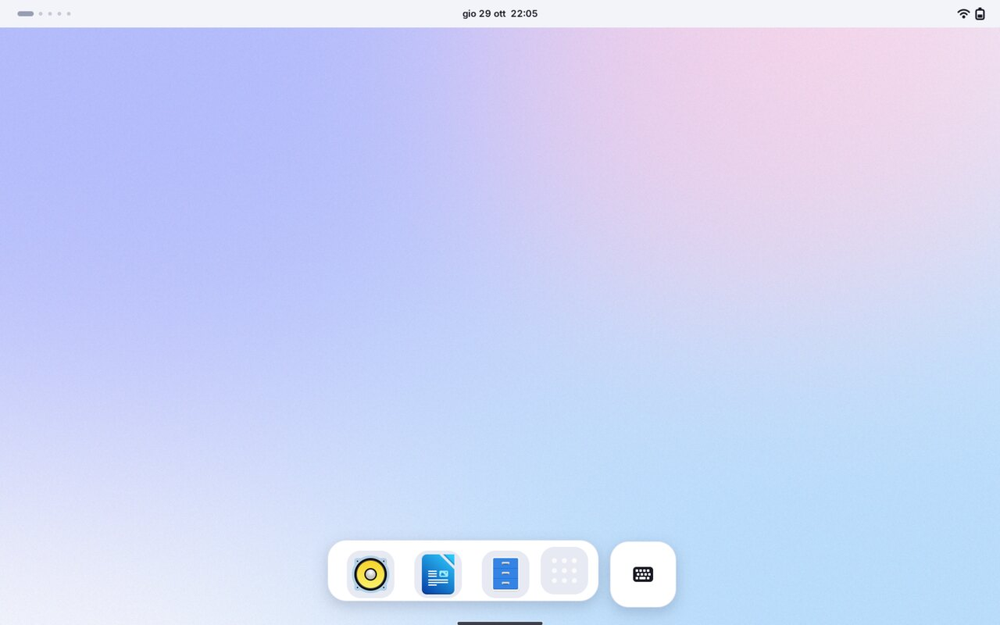

| Home | All apps | Keyboard |
|---|---|---|
| 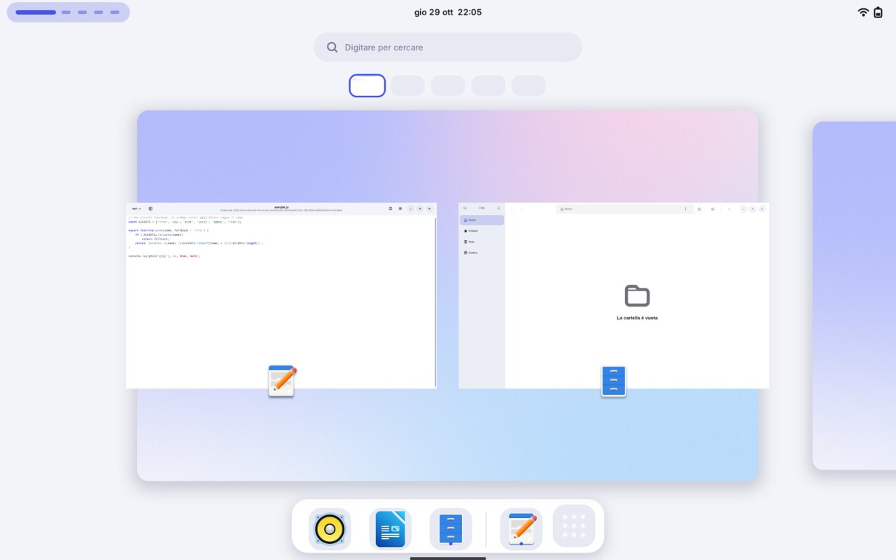 | 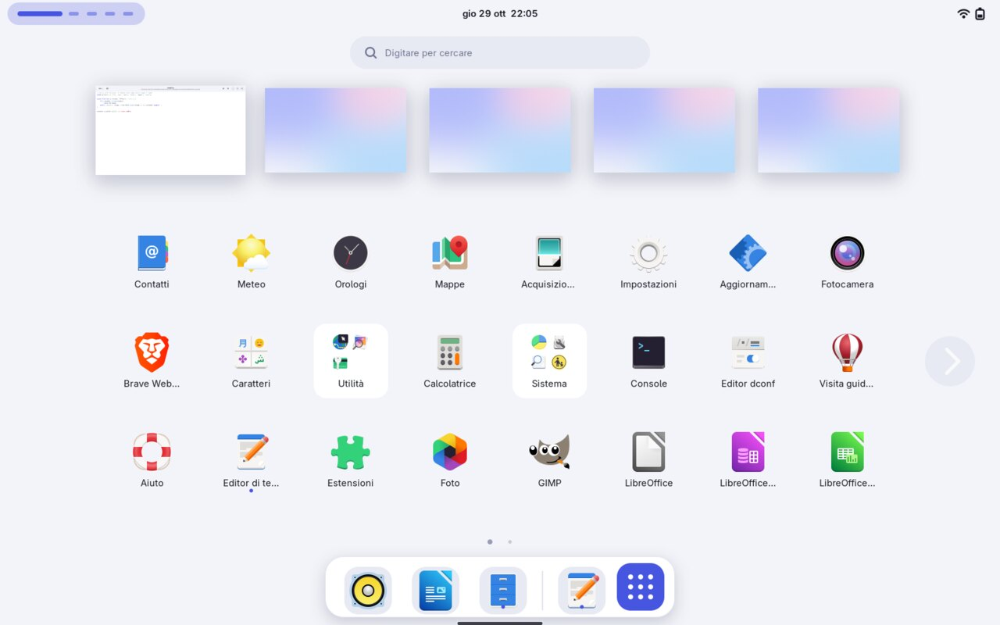 | 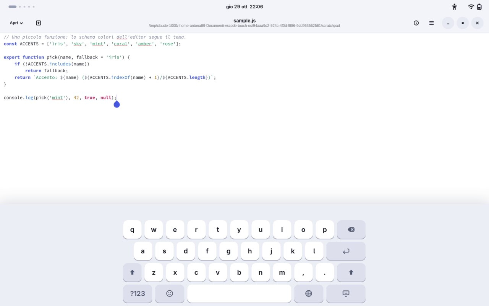 |

The Shell follows the system scheme, like apps do.

### Touch OS Settings

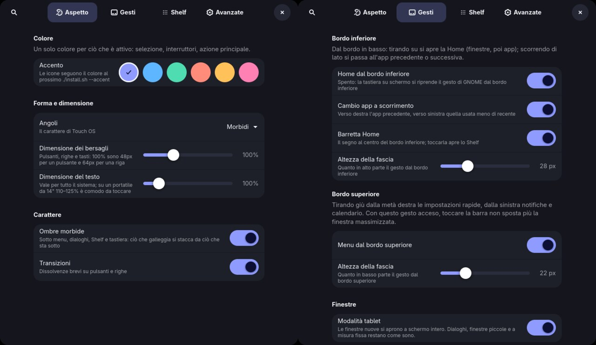

A panel with four pages, opened from the **Touch OS Settings** entry (app menu) or the Extensions app. The menu entry also
works right after installing, before the first new login (see [Troubleshooting](#troubleshooting)):

| Page | What it controls |
|---|---|
| **Appearance** | accent color; corners (compact / soft / round); target size (80–140%); system text size; shadows; transitions |
| **Gestures** | home gesture, app flip, pill, size of the touch zones; top-edge menus; tablet mode |
| **Shelf** | on/off, stay open on an empty desktop, keyboard button, auto-close delay; motion on/off and speed |
| **Advanced** | close Nautilus to apply the theme, regenerate the theme, restore defaults |

Gestures and the Shelf react immediately. *Appearance* changes regenerate the CSS: the Shell updates on the fly, GNOME apps
at their next launch.

### Editors and terminals

| Where | How |
|---|---|
| Text Editor, Builder… | scheme *Touch* (`touch` / `touch-dark`), installed in `~/.local/share/gtksourceview-5/styles/`; the installer selects it in Text Editor |
| Ptyxis | palette *Touch*, installed and selected |
| alacritty, kitty, foot, ghostty | `~/.local/share/themes/Touch/extras/terminals/`: include the file from your config (the first line of each says how) |
| GNOME Console | its palette is not themable |

### Tweaking from the command line

The extension's settings live in its own folder, so `gsettings` needs to be told where:

```bash
S="$HOME/.local/share/gnome-shell/extensions/touch-shell@touch-os/schemas"
gsettings --schemadir "$S" set org.gnome.shell.extensions.touch-shell accent 'coral'       # iris sky mint coral amber rose
gsettings --schemadir "$S" set org.gnome.shell.extensions.touch-shell touch-scale 120      # 80–140 (%)
gsettings --schemadir "$S" set org.gnome.shell.extensions.touch-shell home-zone 36         # px of the bottom touch zone
gsettings --schemadir "$S" set org.gnome.shell.extensions.touch-shell shelf-timeout 0      # never auto-close the Shelf
gsettings --schemadir "$S" set org.gnome.shell.extensions.touch-shell auto-maximize false
```

Changing a theme key (accent, radii, scale…) regenerates the CSS only from the settings panel; from the command line run
`gjs -m tools/render-theme.js --settings-from "$HOME/.local/share/gnome-shell/extensions/touch-shell@touch-os"` and then
log out, or bump `theme-serial` to make the Shell reload.

## Uninstalling

```bash
./uninstall.sh
```

It puts every setting back to the value it had before (including the list of enabled extensions, the hot corner and the text
size), restores any `~/.config/gtk-3.0/gtk.css` and `gtk-4.0/gtk.css` of yours, and removes only what the installer created
from scratch.

## How it is built

| Part | Where | Notes |
|---|---|---|
| Edge gestures, pill, Shelf, tablet mode | `extension/touch-shell@touch-os/` | GNOME Shell extension (ESM). `home.js` bottom edge (Home, app flip, pill), `top.js` top edge, `shelf.js` the Shelf, `tablet.js` auto-maximize, `util.js` where a touch started, `theme.js` loads the Shell stylesheet (light or dark), `prefs.js` the settings, `touch-settings` + `prefs-standalone.js` the settings launcher |
| Palette (colors) | `extension/…/palette.js` | the single source of truth: neutrals for both schemes, accents, ANSI |
| libadwaita (GTK4) apps | `theme/Touch/gtk-4.0/touch.css` | libadwaita apps ignore the theme and only read `~/.config/gtk-4.0/gtk.css`: the installer points it at this file. Light/dark through `@media (prefers-color-scheme)` |
| GTK3 apps | `theme/Touch/gtk-3.0/` | [adw-gtk3](https://github.com/lassekongo83/adw-gtk3) base (downloaded, pinned, SHA-256) + the palette; the overrides are also linked at `~/.config/gtk-3.0/gtk.css`, because adw-gtk3's selectors are more specific than anything a theme can say |
| Non-libadwaita GTK4 apps | `theme/Touch/gtk-4.0/gtk.css` | adw-gtk3 base + Touch overrides |
| GNOME Shell | `theme/Touch/gnome-shell/gnome-shell-{dark,light}.css` | overrides only, on top of the Shell's default CSS; the extension loads the one that matches the system scheme |
| Theme sources | `theme/Touch/templates/*.in` | The real CSS files are generated from these templates by the installer or the settings panel (`tools/render-theme.js`, engine in `themegen.js`), so they are not stored in the repository |
| Editor/terminal schemes | `theme/Touch/templates/extras/` | same engine |
| Desktop settings | `config/desktop.settings` | one line per key: `schema \| key \| value` |

Two things worth knowing about St, the Shell's CSS engine: it draws only a *uniform* `border` and accepts a single
`box-shadow` per node (so a node has a shadow *or* a focus ring). Both are handled in the templates. The design reasoning,
and the traps found on the way (the top bar's window drag, the keyboard's edge gesture), are in
[docs/DESIGN.md](docs/DESIGN.md).

### Known limits

- **Verified in a headless GNOME Shell 50.5** (the test bench below: theme, gestures, Shelf, tablet mode, settings, installer
  and uninstaller round-trip in an isolated home with a file-backed GSettings), on openSUSE Tumbleweed, with a **virtual
  touchscreen**. It has not been tried with a finger on a physical screen yet: if a gesture feels too eager or too
  stubborn, the numbers to change are *Touch zone height* (settings), `FLIP_COMMIT` / `FLIP_VELOCITY` at the top of
  `home.js` and `BEGIN_PX` in `top.js`. If something misbehaves at your first login,
  `journalctl --user -b /usr/bin/gnome-shell | grep -i touch` tells you what, and `./uninstall.sh` puts everything back.
- The extension hooks Shell internals: it reuses `SwipeTracker` and the overview's gesture handlers, reads the panel's
  `_clickGesture` and the keyboard's `_bottomDragGesture`, and instantiates the Dash. It declares GNOME 50 only; a GNOME update
  is the most likely thing to break it.
- Two-finger gestures (pinch, rotate) are the apps' own. Window resizing by touch relies on the wide invisible border the
  theme gives GTK windows (their shadow is also their resize zone); apps that draw their own title bar and border (Firefox, Chrome, Electron,
  VS Code…) keep their own controls and sizes.
- The pill and the Shelf live on the primary monitor; the edge gestures answer on any monitor's edge.
- With a window radius above 0, GTK3 windows keep square bottom corners (a GTK3 limitation).
- The icons follow the accent only when you run `./install.sh --accent …` (the settings panel changes the theme, not the icon set).
- The lock screen is not styled: the extension is off while the session is locked.
- GNOME starts in the overview at login; the Shelf takes over the empty desktop as soon as you leave it.

## Development and preview

`tools/preview.sh` shows the app theme without installing anything (it loads from temporary folders):

```bash
tools/preview.sh                          # GTK4/libadwaita test window
tools/preview.sh --scheme light           # light variant
tools/preview.sh gtk3 --dark              # GTK3 variant
TOUCH_SET="corner-radius=28 touch-scale=120 accent=coral" tools/preview.sh
tools/make-wallpapers.sh                  # regenerate the wallpapers (needs ImageMagick)
```

`tools/shell-test/` is a test bench that starts a **headless** GNOME Shell (private bus, your session is not touched) with
the extension, simulates touches, mouse and keyboard, and saves screenshots. It is how every screenshot here was made, and
how the gestures are checked:

```bash
tools/shell-test/shell-test.sh --steps tools/shell-test/steps/gestures.js --out /tmp/shots      # every gesture, with assertions
tools/shell-test/shell-test.sh --steps tools/shell-test/steps/elements.js --out /tmp/shots      # notification, OSD, switcher, dialog, keyboard, apps
tools/shell-test/shell-test.sh --steps tools/shell-test/steps/lifecycle.js --out /tmp/shots     # enable/disable ×4 without leftovers
tools/shell-test/shell-test.sh --scheme light --steps tools/shell-test/steps/docs.js --out /tmp/shots
```

In the CSS, GTK4 uses variables and `color-mix()`; GTK3 only `@colors`, `alpha()` and `mix()`; the Shell (St) has no
`linear-gradient()`, no per-side borders and accepts a single `box-shadow` per node.

## Troubleshooting

- **«Touch OS Settings» does nothing / `gnome-extensions prefs` says the extension "does not exist"**: GNOME Shell only
  discovers a new extension at the next login (Wayland cannot restart the Shell). The menu entry runs `touch-settings`,
  which falls back to opening the panel directly, so it works before that too.
- **The gestures don't answer**: log out and back in (the extension is loaded at login), then check in the *Extensions* app
  that *Touch Shell* is on; if it shows an error, `journalctl --user -b /usr/bin/gnome-shell | grep -i touch`.
  They answer to fingers on the touchscreen only, not to a mouse or a touchpad.
- **Pulling up from the bottom shows the keyboard instead of Home**: the extension isn't active yet (log out and in), or
  *Home from the bottom edge* is off in *Settings → Gestures*, which gives the edge back to GNOME's keyboard.
- **A swipe from the top drags the window instead of opening the menu**: *Menus from the top edge* is off; with it on the
  bar no longer starts dragging for fingers.
- **A button at the very bottom of an app reacts late or doesn't**: the touch zone is 28px high; lower it in
  *Settings → Gestures → Touch zone height* (16px is the minimum).
- **Nautilus or an app still has the old style**: it was already open. Quit it completely (`nautilus -q`) and reopen it.
- **The animations are GNOME's**: *Settings → Shelf → Touch OS animations* may be off, or GNOME's *Animations* setting is off.
- **Some GTK3 app stays light with the dark scheme**: restart it; some older GTK3 apps do not follow the scheme.
- **Your `~/.config/gtk-3.0/settings.ini` sets `gtk-theme-name` or `gtk-decoration-layout`**: it takes precedence over what is
  set in GNOME.
- **I changed my mind about the color**: `./install.sh --accent rose`.

## License

The code, CSS, scripts, wallpapers and images in this repository are released under the **MIT license** (file `LICENSE`; full
list and credits in `THIRD-PARTY.md`). Third-party parts are **not included** and keep their own licenses:

| Component | Author | License | How it reaches your PC |
|---|---|---|---|
| [Tela icon theme](https://github.com/vinceliuice/Tela-icon-theme) | Vinceliuice | GPL-3.0 | downloaded by the installer (or taken from your own `Tela-<variant>/` folder) |
| [adw-gtk3](https://github.com/lassekongo83/adw-gtk3) | lassekongo83 | LGPL-2.1 | downloaded by the installer |

The palette and the wallpapers are original to this project. The screenshots in `docs/` were taken without the Tela icons
(the test bench uses GNOME's own icon set), so your desktop will look slightly different in the icons only.
